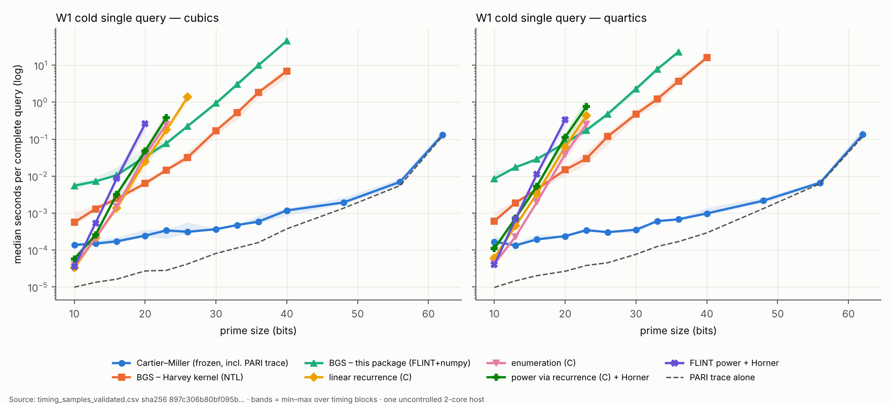
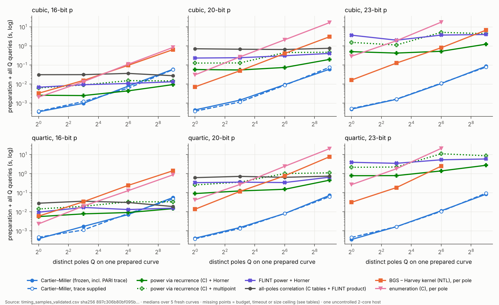

# Cartier–Miller weighted character sums: primary-source audit and matched-output benchmarks

Research report, 20–21 October 2026, prepared for David Jordan's Cartier–Miller programme. It is unrefereed and AI-assisted, and is not specialist review. Nothing was published; the supplied manuscript and the inherited archive were not modified.

**Labels.** **[I]** inherited from the manuscript; **[O]** inherited from the Opus report or the independent review; **[L]** established in the primary literature, with page attribution; **[N]** new deduction or proof in this audit (not specialist-reviewed); **[C]** finite computational evidence; **[M]** measured performance on one host; **[U]** unresolved.

---

## 0. Inputs, integrity and environment

| Item | Identification |
|---|---|
| Handover package | `Cartier_Miller_Prior_Work_Benchmarks_20261020.zip`; all 13 SHA256SUMS entries verified |
| Manuscript source | `inherited/Cartier_Miller_Source_Revision_20261019.tex`, SHA-256 `7419bfc0…a24cb9`, internal revision 19 October 2026 (unchanged) |
| Inherited archive | `Opus_Character_Sums_20261020.zip`, SHA-256 `51fb45ac…49c6`; 48/48 manifest entries and 32/32 frozen files verified; freeze digest `4302b564…99bd3` |
| Frozen candidate | `src/cmcs.py`, SHA-256 `763c8681…c59c`, imported unchanged from a verified extraction; vendored `cm_system` unchanged |
| Handover verifier | `verify_handover.py`: PASS (13/48/32 integrity; 96 models, 2,976 single-pole, 288 + 288 weighted checks). `--with-opus`: PASS, adding 2,865 inherited Miller nonbranch, 111 prepared branch and 576 integration checks. Outputs in `results/handover/` |
| This package's freeze | `code/FREEZE.json`, digest `09202ac1edab4f3eadfa68a8c50e0d77c695328891e889c8a744fc8b28c28ac0` (15 files; local clock; no external timestamp) |
| Host | Linux 6.18.44 x86_64 VM, Intel Xeon @ 2.10 GHz, 2 vCPUs, 7.8 GiB RAM, no swap; uncontrolled cloud host |
| Software | CPython 3.13.16; gcc 13.3.0 (`-O2 -fPIC`, single-threaded); python-flint 0.9.0 (FLINT 3.6.0); cypari2 2.2.4 (PARI 2.17.2, no seadata); numpy 2.5.3; passagemath-ntl 10.8.13 (Harvey's hypellfrob 2.1.1 on NTL) in a separate venv. Full record in `results/environment.json` |

---

## 1. Findings

1. **[L+N] The exceptional case τ = χ(f(a)) follows from Voloch–Semaev.** For a cubic, Voloch's descent polynomial V is exactly the high part H in the polynomial-division identity (A1). For trace one, bV(a) equals Semaev's logarithmic transfer relative to dx/(2y). This gives (A6): C_f(a) = f′(a)/(2b²) − α_p(P)/b. A twist, a translation, the Connell model and the decomposition 1/z = ½(Y + Y_R)/(X − X_R) − g₁/4 extend this to every exceptional cubic or quartic (A7), with no square root. The adapters are derived here (§4); the ingredients are [L].
2. **[N, C] The general-trace case also has a short derivation from classical facts.** Let p ∤ n = #E(F_p) and Q′ = [p^{−1} mod n]P. Then bV(a) = (A − 1)·α_p(Q′) (A7′). A five-line Cartier-operator proof is given in §4.4. The identity is also what Voloch's characteristic-p zeta function gives (Voloch, 1997, p. 2 and Prop. 2) when read with the function field of E embedded via Verschiebung. It held on all 742,648 tested points (689,144 clean chains and 53,504 chains through O; p < 80). A full evaluator built on it (`voloch_zeta_route.py`) passed 11,866 direct and 160 large-prime (30–62-bit) checks. Consequently, after an exact trace, the base-field evaluation capability of Theorem 1 and Corollary 1.1 is obtainable by a different, equally short chain. **The paper's claim should be narrowed to its specific two-pole residue-divisor formulation and its applications** (§10).
3. **[L] The normalization step left open by the literature is a sign.** Voloch (n.d., p. 4) identifies the descent map with Semaev's map only "up to sign". Voloch (1997, p. 4) corrects the 1990 differential scale (dx/y → dx/(2y), "a factor of −2 … missing") and the sign of z, but its quasi-period formula η(P) = −df/(fω) does not by itself fix the composite constant. **[C]** The constant is +1. This is unique among ±1, ±2, ±½, on all 19,150 rational points of all 479 anomalous short models for p ≤ 59, and it is consistent with manuscript (24)–(25).
4. **[N] Matched comparator identity.** H(a) = [z^N] G_a(z)^h with G_a(z) = z^D f(a + 1/z) and N = Dh − p < p (A2). This covers a = 0 and branch poles with no trace. It yields a trace-free O(p) recurrence and a genuine **BGS** comparator: Bostan–Gaudry–Schost block products, Õ(√p) field operations. The BGS comparator was implemented twice: through Harvey's published NTL kernel (`bgs_harvey`) and as a transparent BGS (2007) implementation (`bgs07`). Both were validated against direct enumeration and against each other.
5. **[M] Performance (W1 cold first query, including the exact trace).** The frozen Python candidate takes 0.13–0.20 ms per complete query up to 16 bits and 0.24–1.2 ms from 20 to 40 bits. Harvey's BGS kernel takes 0.56 ms at 10 bits, 14.6 ms at 23 bits, 0.17 s at 30 bits and 6.9 s at 40 bits for cubics; quartics are 1.1–3.7× slower. Native linear methods (C recurrence, C enumeration, FLINT power) win only at 10 bits: the best is 4.2× faster (33 and 40 µs against 138 and 169 µs). They lose from 13 bits on. Above 40 bits only Cartier–Miller (and, for exceptional inputs, the Voloch–Semaev route) was run; the square-root comparators stop at a declared 40-bit ceiling. At 62 bits the PARI trace is 87–92% of the Cartier–Miller median (§9.2). The crossover reflects named implementations on one host. It is not an algorithmic constant.
6. **[M] Reuse and dense queries.** On a prepared curve (W2), Cartier–Miller queries cost 90–310 µs each.
   * At 16 bits, the full polynomial with Horner queries overtakes them between Q = 8 and 64 poles (cubic) and between Q = 64 and 512 poles (quartic).
   * At 20 and 23 bits, Cartier–Miller is fastest for every Q tested, up to 512.
   * In dense workloads (W5: Q = p/16 to all poles, 12–18 bits), the all-poles correlation or the polynomial with multipoint evaluation is 9–147× faster than the Python Cartier–Miller queries.
   * Coefficient-only changes (W3) cost the same O(s) dot product for every method.
   * One weighted sum with s ≤ 256 poles (W4) is fastest with Cartier–Miller at every s.
   * Branch poles (W6) are faster by the trace-free coefficient methods, because the frozen candidate must first run an O(p) second-kind preparation.
7. **[N] Corrections.** All gates in CORRECTIONS_AND_GATES.md are resolved (CORRECTIONS_RESOLUTION.md). They cover the complete-domain statement, the projective N∞ = 0 case, exact resonance conditions (including the new observation that at the branch resonance k = (p + 1)/2 the term becomes a character sum on y² = (x − μ)f(x)), sufficiency phrasing, the regularity and affine qualifiers, and endpoint checks from the chain itself.
8. **[C] Validation.** Development checks totalled 140,636 (system interpreter) and 7,630 (Harvey kernel), all passing. After freezing, hash-seeded confirmation on primes disjoint from the development and inherited lists gave 51,023 and 1,844 checks, all passing. Every timed output was validated outside the timers: 908,368 (output, method) pairs against direct enumeration, 9,043,732 by cross-family consensus, 9,621 by internal checks, and 33,894 traces. That is zero mismatches; 108 one-family W4 outputs passed a separate internal check (§9.11).

---

## 2. The matched output and the identities used

Let p ≥ 7 be prime, h = (p − 1)/2, f ∈ F_p[x] squarefree of exact degree D ∈ {3, 4}, F = f^h = Σ c_m x^m, and χ the quadratic character with χ(0) = 0. The matched scalar is

  C_f(a) = Σ_{x∈F_p, x≠a} χ(f(x))/(x − a) ∈ F_p, returned in [0, p).

**(A1) [O; re-proved].** C_f(a) = −H(a) − F′(a), where F = L + x^p H with deg L < p, and F′(a) = h f(a)^{h−1} f′(a). *Proof:* on F_p, F(x) = χ(f(x)). Put Q = (F − F(a))/(x − a); then Σ_{x≠a} χ(f(x))/(x − a) = Σ_x Q(x) − Q(a), Σ_x Q(x) = −[x^{p−1}]Q = −H(a), and Q(a) = F′(a). ∎

**(A2) [N for this use; supplied by the handover, proved here].** H(a) = [z^N] G_a(z)^h with G_a(z) = z^D f(a + 1/z) and N = Dh − p. *Proof:* (a + w)^p = a + w^p in characteristic p, so F(a + w) = L(a + w) + aH(a + w) + w^pH(a + w). The first two terms have degree < p, hence [w^p]F(a + w) = H(a). Since G_a^h = z^{Dh}F(a + 1/z), [z^k]G_a^h = [w^{Dh−k}]F(a + w); take k = N. ∎ N = (p − 3)/2 for cubics and N = p − 2 for quartics, so 0 ≤ N < p. G_a(0) = ℓ ≠ 0 for every a, including branch values.

**Recurrence (A10).** From G(G^h)′ = hG′G^h, with G = Σ g_j z^j and G^h = Σ e_k z^k: comparing coefficients of z^{k−1} gives k g₀ e_k = Σ_{j=1}^{min(D,k)} ((h + 1)j − k) g_j e_{k−j}, with e₀ = g₀^h.

**Constant terms.** Σ_x χ(f(x)) ≡ −c_{p−1} − [D = 4]χ(ℓ) (mod p), and c_{p−1} = [z^{N+1}]G_a^h for every a, since c_{p−1} ≡ τ is translation-invariant. Trace-free methods therefore obtain the constant-term input one recurrence step after e_N. This was validated in development as `S.sum_eps_from_H` and `S.*.query_with_H`.

---

## 3. What the Voloch and Semaev constructions provide

Reading method: SOURCE_LEDGER.md. Page numbers are journal pages unless stated.

**3.1 Voloch (1990) [L, partial read].** For a Weierstrass model with a₁ = a₃ = 0, p ≠ 2, E ordinary over a field K of characteristic p, Voloch introduces polynomials U, V with deg U ≤ p − 2. The text around the missing display (2) says "A is the Hasse invariant". Lemma 1.1 (pp. 248–249): the cover z^p − Az = yV(x) is étale of degree p. Prop. 1.3 (pp. 249–250): if c^{p−1} = A with c ∈ K, then α(x, y) = yV(x)/c^p is a homomorphism E(K) → K⁺/℘(K⁺) with kernel φ(E′(K)). There is no trace-one hypothesis and no algorithm or cost. *Deduction [N]:* over K = F_p, (F_p^×)^{p−1} = {1}, so the hypothesis is A = 1, i.e. τ ≡ 1 mod p, i.e. τ = 1 for p ≥ 7. Then ℘(F_p) = 0 and α: E(F_p) → F_p.

**3.2 Voloch (1997) [L].** p. 2: y^{p−1} = f^{(p−1)/2} = U + Ax^{p−1} + x^pT(x), deg U ≤ p − 2. z is a function on E^{(p)} with z^p − Az = −yT(x), normalized by z + y/x vanishing at 0, and the function field of E is viewed inside that of E^{(p)} via V. Prop. 1 (p. 3): z(P + P₀) = z(P) + η(P₀) for P₀ ∈ ker V; dz/ω = −x + B/A. Prop. 2 (p. 3): z(P + Q) = z(P) + z(Q) + (y(Q) − y(P))/(x(Q) − x(P)). p. 4: η(P) = −df/(fω) for div f = p((P) − (0)). p. 4 also corrects the 1990 paper: "the differential dx/y was used when it should have been dx/(2y)", "a factor of −2 being missing throughout the paper", and "what is denoted by z in [V] is denoted here by −z". The paper has no trace assumption and no algorithm.

**3.3 Voloch (n.d.) [L].** p. 3: for curves with p points, y² = x³ + a₂x² + a₄x + a₆ = f(x), f^h = U + Ax^{p−1} + x^pM with A = 1, and α(x, y) = yM(x) is the descent map E(F_p) → Z/p. p. 4: Semaev's map is α(Q) = df_Q/(f_Qω) with ω = df/f for a fixed P, so it is scale-free with α(P) = 1. The two maps "agree up to sign"; Smart and Satoh–Araki give the same map except for the canonical lift. Vnd2 repeats the scale-free normalization.

**3.4 Semaev (1998) [L].** On y² = x³ + Ax + B over F_q, q = p^l, p ≠ 2, 3, for a subgroup ⟨P⟩ of order p (anomaly over F_p is not assumed): (f_Q) = p((Q) − (P_∞)) and φ(Q) = (f_Q′/f_Q)(R) with ′ = d/dx at a fixed R ∈ ⟨P⟩ − {P_∞} (pp. 354–355). Lemma 2: φ embeds ⟨P⟩ in F_q⁺. Lemma 3: O(ln p) operations in F_q, using D_Q = (Q + S) − (S) with S of order 2 (pp. 355–356). The output is absolute: φ(Q) = Ψ_{dx/2y}(Q)/(2y(R)) **[N]**, checked as H1′ (13,338 checks; 5,812 skipped where no auxiliary R was available).

**3.5 Rück (1999) [L, abstract only].** Discrete logarithms in Pic⁰(X)_{p^n} in O(n² log p) operations. This is p-power torsion only, so it covers exceptional-type inputs at most.

**3.6 The constant [C].** `code/source_audit/voloch_semaev_normalization.py` uses no inherited code. It examined all short Weierstrass curves with trace ±1 for p ≤ 59: 479 curves of each trace, counting isomorphic models separately. **H1:** b·T(a) = α_p(P) for all 19,150 points, where α_p is the Miller constant at O in z = −x/y with M = p; the scalings −1, ±2 and ±½ matched 0 times. **H1′** (Semaev's form): 13,338/13,338. **H2** (additivity): 68,324/68,324 pairs. **H3** (matched sum (A6)): 19,150/19,150. **H4** (trace −1 via the twist): 9,575/9,575. Thus T in Voloch 1997, M in Voloch n.d. and V in Voloch 1990 are the coefficient block c_p, …, c_{3h}, and the composite constant is +1 relative to dx/(2y). The sign is the only normalization the sources leave to the reader; it is the step the manuscript's (24)–(25) and Lemma 3 fix.

---

## 4. Conversions derived here

**4.1 Cubic, trace one, χ(f(a)) = 1 [N].** For a monic cubic, V = H (compare 3.1 with (A1)). With P = (a, b), F′(a) = −f′(a)/(2b²) and bV(a) = α_p(P), so

  (A6) C_f(a) = f′(a)/(2b²) − α_p(P)/b.

General cubics reduce to this by X = ℓx (C_f(a) = ℓC_g(ℓa)) and by translation. Cost: O(log p) field operations and one square root; the square root is avoided in 4.2.

**4.2 All exceptional inputs [N].** Suppose τ = χ(f(a)) ∈ {±1}, with D ∈ {3, 4}, any constant term and f(a) ≠ 0.

(i) *Twist.* Take d = 1 if χ(f(a)) = 1 and d = f(a) otherwise; the curve y² = df(x) has trace χ(d)τ = 1 and df(a) is a nonzero square, and C_f(a) = χ(f(a))·C_{df}(a).
(ii) *Normalize.* Put g(z) = df(a + z)/(df(a)), so g(0) = 1 and C_{df}(a) = C_g(0).
(iii) *Model.* On the Connell short model with origin P₊ = (0, 1) (manuscript (26)–(29)), let R be the image of P₋ = (0, −1). It is given by the exact w → 0 limit, so no square root is needed.
(iv) *Decomposition.* L((O) + (R)) is spanned by 1 and h_R = (Y + Y_R)/(X − X_R), and 1/z has simple poles exactly at P₊ ↦ O and P₋ ↦ R. Near P₊, the expansions (28) give X = 4w^{−2}(1 + (f₁/2)w + …) and Y = 8w^{−3}(1 + (3f₁/4)w + …). Hence Y/X = 2w^{−1}(1 + (f₁/4)w + …) and h_R = Y/X + O(w). Matching the pole and constant terms gives 1/z = ½h_R − g₁/4, verified pointwise at 82,413 points (`quartic_adapter_check.py`).
(v) *Sum.* Summing over E(F_p) ∖ {O, R}, which is in bijection with C(F_p) ∖ {P±} (points at infinity of C carry 1/z = 0): Σh_R = Y_R C_W(X_R) − W′(X_R)/(2Y_R), by the affine single-point identity (A11) on W, and this equals −α_p(R) by (A6) on W. The count is #E = p, so Σ1 ≡ −2. Therefore

  (A7) C_f(a) = χ(f(a))·( f′(a)/(2f(a)) − α_p(R)/2 ),  equivalently H(a) = χ(f(a))·α_p(R)/2.

The summed identity Σh_R = −α_p(R) was checked directly on 7 anomalous short models. The implementation `voloch_semaev` passed 1,679 small-p exceptional checks against direct enumeration and 42 + 42 CM-constructed large-p checks (24–63 bits) against the inherited candidate. Where p < 10¹⁰ the BGS comparator also agreed; W7 adds agreement with Harvey's kernel up to 40 bits. The factor 2 of Lemma 3 belongs to the representative (P) − (−P) and does not enter (A7).

**4.3 Scope [N].** Semaev's map needs a rational subgroup of order p. Over F_{p^m} this exists iff p | #E(F_{p^m}), i.e. iff τ^m ≡ 1 (mod p), since #E(F_{p^m}) ≡ 1 − τ^m (mod p). For τ ≠ χ the needed extension degree is the multiplicative order of ±τ mod p, which is generally exponential in log p. The anomalous constructions alone therefore do not reach the regular case.

**4.4 General trace by division by p [N].** *Proposition (A7′).* Let y² = f(x) be a monic cubic with Hasse invariant A = c_{p−1}, n = #E(F_p) ≢ 0 (mod p), P = (a, b) ∈ E(F_p) with b ≠ 0, and Q′ = [p^{−1} mod n]P. Then bV(a) = (A − 1)·α_p(Q′).

*Proof.* Let ω₀ = dx/(2y) and ϑ_P = ((y + b)/(x − a))ω₀, which has simple poles and residue divisor (P) − (O).

(a) Since F(a) = 1, q = (F − 1)/(x − a) is a polynomial of degree < 2p − 1 with [x^{p−1}]q = V(a). Using C(g^pη) = gC(η), 1/y = F/y^p and C(dx/(x − a)) = dx/(x − a):
  C(dx/((x − a)y)) = y^{−1}(V(a)dx + dx/(x − a)), so (C − id)ϑ_P = bV(a)ω₀.
No assumption on the trace is used.

(b) f_{p,Q′} has divisor p(Q′) − (P) − (p − 1)(O), so θ = −dlog f_{p,Q′} has residue divisor (P) − (O) and C(θ) = θ.

(c) In t = −x/y, x is even and y odd under the involution, so ϑ_P/ω₀ = (y + b)/(x − a) = −t^{−1} + O(t) has no constant term. Also θ = −(t^{−1} + α_p(Q′) + O(t))dt, and ω₀ = (1 + O(t²))dt. Hence the holomorphic differential ϑ_P − θ equals α_p(Q′)ω₀.

(d) Applying C − id and C(ω₀) = A^{1/p}ω₀ = Aω₀ gives bV(a) = (A − 1)α_p(Q′). ∎

*Relation to Voloch (1997).* Evaluating z^p − Az = −yT(x) at a rational Q′ with V(Q′) = [p]Q′ = P gives (1 − A)z(Q′) = −bT(a). Expanding z([p]Q″) with Prop. 2 (coordinates pulled back along V) gives z(Q′) = α_p(Q′) when the chain avoids O. The other reading, with coordinates on E^{(p)} directly, was tested and rejected: the best variant matched 83,050 of 689,144 cases.

*Evidence [C].* bV(a) = (A − 1)α_p([p^{−1}]P) held for all 689,144 points with clean chains on 13,560 short models (p < 80, B ≡ 0 mod 3) and for all 53,504 points whose chain passes through O (p < 60). The general cubic/quartic version (A7″) adds the decomposition of 4.2(iv) and n ≡ 1 − τ̃. It passed 11,866/11,866 small-p direct checks (11,679 general and 187 exceptional, 1,059 through O) and 160/160 checks at 30–62 bits against the frozen candidate.

  (A7″) C_f(a) = χ(f(a))·( (g₁/4)(1 + τ̃) − (τ̃ − 1)·α_p([p^{−1} mod ñ]R)/2 ), with τ̃ ≠ 1 the twisted trace and ñ = p + 1 − τ̃.

*Cost.* The trace, one scalar multiplication by p^{−1} mod n and one Miller chain of length ⌊log₂ p⌋: O(log p) field operations and inversions after the trace, the same order as Theorem 1. A timing comparison was not part of the frozen benchmark (post-freeze route); an exploratory timing is in §9.10.

**4.5 Consequence for the manuscript.** After an exact trace, every admissible base-field value S_f(λ) = T_f(1/λ) follows from C_f(1/λ) by Corollary A2's O(1) conversion. C_f is available from (A7) in the exceptional case, a direct consequence of Voloch (1990, 1997) and Semaev (1998), and from (A7′)/(A7″) in the regular case, a five-line consequence of classical Cartier facts that is also implicit in Voloch's zeta function. Theorem 1 remains a distinct formulation: the two-pole residue divisor, the annihilator M_χ = p + 1 − χτ, the quadratic algebra and the exceptional normalization of Lemma 3. Its evaluation capability is not, on this evidence, a new capability. **[U]** Neither Theorem 1's regular case nor (A7′) was located in the sources read, and the unread items in the ledger (the anomalous-attack expositions, Gunji 1976, Cassels 1971, Harvey 2007, Miller 2004) could contain either; ePrint 2017/187 was read and does not.

---

## 5. Comparator mathematics and complexity

**Companion form [N].** Let W_k = D_k(e_k, e_{k−1}, …, e_{k−D+1}) with D_k = k!g₀^k. Then W_k = A(k)W_{k−1}, where A(k)[0][j − 1] = ((h + 1)j − k)g_j for 1 ≤ j ≤ D, A(k)[i][i − 1] = kg₀ for i ≥ 1, and all other entries are 0. Every entry is linear in k: A(k) = A₀ + kA₁. *Check:* row 0 is D_k e_k = D_{k−1}·kg₀e_k = Σ_j ((h + 1)j − k)g_j·D_{k−1}e_{k−j}; rows i ≥ 1 are D_k e_{k−i} = kg₀·D_{k−1}e_{k−i}. W₀ = (g₀^h, 0, …, 0). Then e_N = (A(N)⋯A(1))[0][0]·g₀^h/D_N, and D_N = N!g₀^N is a unit because N < p and g₀ = ℓ ≠ 0. D_N is a second, 1 × 1 interval product.

**Costs.**
* *Linear recurrence:* O(p) field multiplications, one inversion, O(D) working elements, no trace.
* *BGS block products:* by BGS (2007, Thm 14, author version), for n = D the product costs O(MM(n)√N + n²M(√N)) = Õ(√p) field operations, with O(n²√N) storage. The hypotheses are units among 2, …, 2^s + 1 and the shift-point units.
  * For `bgs07`, every unit inverted is β = k, 1, …, d, or α + tk with |t| ≤ d and α ∈ {(d + 1)k, d, d + (d + 1)k, c(k + 1)k}. Each is a nonzero integer of absolute value < 2p that is not a multiple of p when p > 4k + 3, by parity in the one borderline case. The code checks every unit at run time and falls back to the naive product for N < 256.
  * For Harvey's kernel the source states its preconditions, and validation covers every prime from 7 upward.
* *Full power:* computing F = f^h by FLINT binary powering costs Õ(p) and O(p) words. Horner evaluation costs O(N) per query; subproduct-tree multipoint evaluation costs O(M(p) log p) for up to p points.
* *Enumeration:* Θ(p) per query. The all-pole correlation C(a) = Σ_{t≠0}χ(f(a + t))/t is one product of two length-p polynomials, O(M(p)).
* *Cartier–Miller (inherited):* the trace, then O(log p) per query. PARI's ellap uses a CM formula when one applies and otherwise baby-step/giant-step in Õ(p^{1/4}) below about 30 digits (installed documentation). Schoof gives O(log⁹ p) deterministically. SEA is heuristically Õ(log⁴ p) but is not used by PARI in this range.

In terms of field operations, the trace-free Õ(√p) route loses asymptotically to any trace method faster than √p followed by O(log p) queries. This is a statement about the algorithms, separate from the measurements in §9.

---

## 6. Named implementations and contracts

| Method | Matched output | Supplied / acquired | Implementation |
|---|---|---|---|
| `cmcs_frozen` | C_f(a), nonbranch | cold: exact trace by PARI ellap on the scaled cubic or on the quartic Jacobian E_{I,J}, validation, sessions; prepared: Curve object reused | inherited Python, unchanged |
| `cmcs_frozen[trace supplied]` | same | trace given for free (workload assumption) | same |
| `cmcs_frozen[second-kind prepared]` | branch values | + O(p) Python second-kind recurrence | same |
| `cmcs_frozen+weighted_sum` | W4 sums | inherited API | same |
| `voloch_semaev` | exceptional inputs only | hypothesis τ = χ(f(a)) = ±1 | this package, Python |
| `bgs_harvey` | all a | nothing | Harvey's hypellfrob 2.1.1 (NTL zz_p) via passagemath-ntl; adapter `cmbench/harvey.py` |
| `bgs07` | all a, p < 2⁵⁰ | nothing | this package: BGS Thms 5/8/14 structure, FLINT `nmod_poly` products, numpy mulmod |
| `linrec_py` / `linrec_c` | all a | nothing | handover reference (unchanged) / C port |
| `flint_power`, `polyrec_c` (± `+multipoint`) | all a | F = f^h by FLINT `nmod_poly_pow`, or H by a C recurrence; Horner or FLINT subproduct-tree multipoint | FLINT 3.6.0 / C + FLINT |
| `enum_c`, `enum_conv` | all a | squares bitmap; ε and 1/t tables plus one FLINT product | C / C + FLINT |
| `cmcs_v2` (corrected variant) | adds V2-1..3 | validated (K1–K3), not benchmarked | Python subclass of the frozen code |
| `voloch_zeta_route` (post-freeze) | all a, any trace | trace | Python, separately hashed |

The trace provider maps a cubic f₀ + f₁x + f₂x² + ℓx³ to Y² = X³ + f₂X² + ℓf₁X + ℓ²f₀, and a quartic to Y² = X³ − 27IX − 27J. It was validated against direct counts on 132 development and 56 confirmation quartic draws, including both square classes of ℓ and f(0) = 0.

---

## 7. Corrections

See CORRECTIONS_RESOLUTION.md (gate by gate, with evidence keys) and CHANGE_LOG.md (C1–C15). The corrected proposed section is `manuscript/PROPOSED_APPLICATION_SECTION_CORRECTED.tex`; it compiles stand-alone (5 pp.).

---

## 8. Validation, freeze and case selection

* **Development** (seed `20261020-dev`): 140,636 checks in families T, S, B, M, X, W and K, plus 7,630 Harvey-kernel checks, including 20 large-p references agreed by `cmcs_frozen` and `bgs07`. All passed. Primes: every prime from 7 to 139, a set of medium primes, 10⁵ + 3, 10⁶ + 3, 10⁷ + 19, 10⁹ + 7, 2⁶¹ − 1 and 10¹⁸ + 9, plus CM-constructed exceptional curves at 24–62 bits.
* **Freeze:** digest `09202ac1…28ac0`, written after development and before any confirmation selection.
* **Confirmation** (seed = freeze digest): primes drawn by a hash-seeded rule from ranges with every development prime and every prime listed in the inherited archive excluded; CM curves with new bit sizes and discriminants. 51,023 checks plus 1,844 Harvey checks, all passing.
* **Benchmark cases:** seed sha256(digest‖"|benchmark"); a new prime per W1 instance, again excluding the development and inherited lists; W7 from CM constructions over D ∈ {−3, −11, −19, −43, −67, −163} with alternating τ = ±1 (not only j = 0/1728).
* **Independence of references.** Direct enumeration (handover Python) was used for p < 2¹⁴. Above that, consensus of at least two method families (Miller, prior, coefficient, enumeration) was required, with no disagreement allowed. Where only Cartier–Miller ran (W1 above 40 bits, and W1 instances beyond the slower methods' blocks), the check is internal: the inherited oracle with two different translation parameters, plus the corrected variant's chain-endpoint test. These are labelled "internal consistency only".
* **Not rerun:** the inherited 208,272/261,423-check suites.

---

## 9. Benchmarks [M]

All numbers in this section are measurements of named implementations on one uncontrolled 2-vCPU host (§0). They are medians over timing blocks unless stated otherwise. Full tables, with min–max over blocks, peak memory and the validation label of every cell, are in `results/analysis/tables.md`. The raw per-block samples are in `results/bench/timing_samples_validated.csv`. No timing anywhere in this report is extrapolated; a cell without a measurement says why (ceiling, budget, pred. budget, timeout).

### 9.1 Design (as run)

* **Matched outputs.** Every method returns the same residue C_f(a), or the same weighted sum, for the same input and excluded set. A trace provider is charged wherever Cartier–Miller needs one (W1 and the cold columns). Methods that need no trace are never charged one.
* **Isolation.** Each (workload, group, method) ran in a fresh interpreter, sequentially, in a seeded random method order. The Harvey kernel ran under the passagemath interpreter. Imports, interpreter start-up and PARI initialization are excluded from every timing and recorded separately. One untimed warm-up call on a dedicated instance loads lazy imports.
* **Timing.** `perf_counter_ns` around the measured region only. Pilots on separate instances chose repetitions per block (target about 40 ms, at most 200 repetitions, up to 9 blocks, job cap 40 s). Slow calls use one repetition per block and fewer blocks.
* **Fresh state.** W1 and W7 use a new prime, curve and pole for every repetition; no instance is reused within a job. W2–W6 use a fresh curve per block, with preparation charged once per block.
* **Budgets.** W1/W7: soft budget 2 s per call, and a declared extended budget of 60 s for the square-root comparators and for Cartier–Miller at ≥ 30 bits. W2–W6: 20–30 s per block (W5: 30 s). Monotone skips ("pred. budget", "budget after smaller class") and fixed size ceilings were declared before the run and are labelled; none is converted into a timing. Hard timeouts are recorded as `timeout`.
* **Memory.** Peak RSS of each worker minus its post-import RSS; a 6 GiB address-space safety limit. A working-memory ceiling of 512 MiB was declared and applied only through per-method bit ceilings, not enforced at run time. Thirteen W2 jobs at 23 bits exceeded it, all FLINT-power or multipoint variants, at 517 MiB–1.1 GiB. They are reported and flagged in §9.4; none was the fastest method in its cell.
* **Validation.** Every timed output was checked after the run, outside the timers (`validate_outputs.py`; §9.11).
* **Interruption.** A host restart at about 02:13 on 21 October stopped the run in W5, after 10,707 data rows, before `bench.py` wrote its case pools and metadata. `resume_after_restart.py` then ran only the missing W5 jobs (one Harvey pilot in `b18_d3_Qp/1` and the three `b18_d4` groups) with the unchanged harness (`bench.py` SHA-256 `eb46a6e0…d0b40d2`), the same seeds, budgets and rules. These are file lines 10,709–10,881 of the CSV, listed in `bench_resume.log`. The same script regenerated the deterministic pools (`cases_regenerated.json`) and wrote `bench_meta.json`. A wrong regeneration would have shown up as mismatches against direct enumeration and internal checks; there were none. The post-run scripts `validate_outputs.py` and `analyze.py` are not part of the freeze; after the run they were changed only in file parsing (group ids containing `/`, workload-prefixed pool keys) and plotting.

### 9.2 W1 — cold first query (complete cost)

Cubics (median per complete query; cmcs_frozen includes the PARI trace, validation and translation sessions; "PARI trace alone" was measured on separate fresh instances of the same class):

| bits | cmcs_frozen | bgs_harvey | bgs07 | linrec_c | enum_c | flint_power | polyrec_c | PARI trace alone |
|---|---|---|---|---|---|---|---|---|
| 10 | 138.3 µs | 561.0 µs | 5.52 ms | 33.2 µs | 38.7 µs | 35.1 µs | 57.6 µs | 9.9 µs |
| 13 | 150.0 µs | 1.31 ms | 7.18 ms | 214.8 µs | 208.7 µs | 536.0 µs | 258.7 µs | 13.5 µs |
| 16 | 172.9 µs | 2.45 ms | 10.63 ms | 1.38 ms | 1.51 ms | 8.68 ms | 3.25 ms | 16.4 µs |
| 20 | 245.8 µs | 6.34 ms | 33.53 ms | 25.04 ms | 36.57 ms | 259.61 ms | 47.67 ms | 27.3 µs |
| 23 | 340.5 µs | 14.61 ms | 77.02 ms | 177.51 ms | 251.13 ms | budget (pilot 2.34 s) | 385.35 ms | 28.3 µs |
| 26 | 312.4 µs | 32.18 ms | 225.61 ms | 1.37 s | budget (pilot 3.17 s) | ceiling | ceiling | 42.2 µs |
| 30 | 366.5 µs | 170.21 ms | 939.44 ms | pred. budget | ceiling | ceiling | ceiling | 81.3 µs |
| 33 | 476.5 µs | 519.89 ms | 3.05 s | ceiling | ceiling | ceiling | ceiling | 114.1 µs |
| 36 | 588.5 µs | 1.84 s | 9.98 s | ceiling | ceiling | ceiling | ceiling | 160.0 µs |
| 40 | 1.18 ms | 6.90 s | 45.65 s | ceiling | ceiling | ceiling | ceiling | 375.0 µs |
| 48 | 1.94 ms | ceiling | ceiling | ceiling | ceiling | ceiling | ceiling | 1.36 ms |
| 56 | 7.00 ms | ceiling | ceiling | ceiling | ceiling | ceiling | ceiling | 5.56 ms |
| 62 | 131.73 ms | ceiling | ceiling | ceiling | ceiling | ceiling | ceiling | 121.79 ms |

Quartics:

| bits | cmcs_frozen | bgs_harvey | bgs07 | linrec_c | enum_c | flint_power | polyrec_c | PARI trace alone |
|---|---|---|---|---|---|---|---|---|
| 10 | 168.7 µs | 610.4 µs | 8.48 ms | 61.8 µs | 43.0 µs | 40.1 µs | 110.3 µs | 9.8 µs |
| 13 | 133.8 µs | 1.90 ms | 17.32 ms | 453.0 µs | 231.6 µs | 690.3 µs | 730.7 µs | 14.8 µs |
| 16 | 194.7 µs | 4.43 ms | 28.89 ms | 3.31 ms | 1.97 ms | 11.17 ms | 5.31 ms | 20.3 µs |
| 20 | 238.8 µs | 14.78 ms | 78.63 ms | 61.59 ms | 38.93 ms | 336.63 ms | 113.06 ms | 26.8 µs |
| 23 | 347.3 µs | 29.92 ms | 175.57 ms | 429.14 ms | 254.89 ms | budget (pilot 4.07 s) | 757.50 ms | 38.4 µs |
| 26 | 305.3 µs | 117.78 ms | 478.13 ms | budget (pilot 4.27 s) | budget (pilot 4.41 s) | ceiling | ceiling | 45.4 µs |
| 30 | 355.9 µs | 474.16 ms | 2.30 s | pred. budget | ceiling | ceiling | ceiling | 77.0 µs |
| 33 | 608.0 µs | 1.21 s | 7.82 s | ceiling | ceiling | ceiling | ceiling | 125.2 µs |
| 36 | 680.1 µs | 3.73 s | 22.94 s | ceiling | ceiling | ceiling | ceiling | 169.6 µs |
| 40 | 982.5 µs | 16.00 s | budget (pilot 102 s) | ceiling | ceiling | ceiling | ceiling | 292.5 µs |
| 48 | 2.17 ms | ceiling | ceiling | ceiling | ceiling | ceiling | ceiling | 1.33 ms |
| 56 | 6.68 ms | ceiling | ceiling | ceiling | ceiling | ceiling | ceiling | 6.27 ms |
| 62 | 133.69 ms | ceiling | ceiling | ceiling | ceiling | ceiling | ceiling | 116.58 ms |

* **Cartier–Miller.** The frozen Python implementation, with the PARI trace charged, takes 0.13–0.20 ms per complete first query up to 16 bits, 0.24–1.2 ms from 20 to 40 bits, about 2 ms at 48 bits, 7 ms at 56 bits and 0.13 s at 62 bits. From 48 bits the trace is 61–94% of the median (the two medians come from different instances, so the share is approximate).
* **Native linear methods** (C recurrence, C enumeration, FLINT power) are faster only at 10 bits: the best is 4.2× faster for both degrees (33 µs and 40 µs against 138 µs and 169 µs). From 13 bits on, Cartier–Miller is the fastest measured method for both degrees.
* **BGS.** Harvey's kernel grows from 0.56–0.61 ms at 10 bits to 6.9 s (cubic) and 16 s (quartic) at 40 bits. Between 30 and 40 bits its median grew by factors of 41 (cubic) and 34 (quartic) for a 2¹⁰ change in p. That is close to the √p of its theorem; this is a descriptive observation, not a fitted exponent. The transparent `bgs07` implementation is 4–7× slower than Harvey's kernel from 16 bits (up to 14× at 10–13 bits) and could not finish the quartic 40-bit class within the extended budget (pilot 102 s).
* **Ratio at 40 bits.** The cold-query ratio Harvey/Cartier–Miller is about 5,800 (cubic) and 16,000 (quartic) on this host.
* **Coverage.** No square-root comparator was run above its declared 40-bit ceiling.

### 9.3 W7 — exceptional traces (CM-constructed, labelled known-trace family)

| group | cmcs_frozen | cmcs_frozen[trace supplied] | voloch_semaev | bgs_harvey |
|---|---|---|---|---|
| b24_d3_exc | 235.5 µs | 234.4 µs | 55.5 µs | 20.06 ms |
| b32_d3_exc | 508.1 µs | 642.9 µs | 112.5 µs | 357.46 ms |
| b40_d3_exc | 543.0 µs | 424.6 µs | 130.6 µs | 10.17 s |
| b48_d3_exc | 731.7 µs | 633.4 µs | 317.8 µs | ceiling |
| b56_d3_exc | 650.3 µs | 658.0 µs | 222.4 µs | ceiling |
| b62_d3_exc | 1.04 ms | 1.07 ms | 376.6 µs | ceiling |
| b24_d4_exc | 236.4 µs | 242.0 µs | 50.2 µs | 43.49 ms |
| b32_d4_exc | 560.2 µs | 403.5 µs | 118.3 µs | 866.38 ms |
| b40_d4_exc | 535.7 µs | 488.5 µs | 143.9 µs | 19.32 s |
| b48_d4_exc | 671.1 µs | 635.4 µs | 188.0 µs | ceiling |
| b56_d4_exc | 805.3 µs | 794.6 µs | 266.1 µs | ceiling |
| b62_d4_exc | 1.06 ms | 1.04 ms | 309.7 µs | ceiling |

* **Voloch–Semaev route.** (A7) takes 50–380 µs per query, against 0.23–1.1 ms for the frozen Cartier–Miller candidate, i.e. it is 2.0–5.7× faster. Both are Python. The extra time in the frozen candidate goes to translation sessions, the quadratic algebra and validation; the core chain is the same. These are implementation differences, not evidence of an algorithmic advantage either way.
* **Trace cost.** PARI used its CM formula for these curves, so the cold and "trace supplied" Cartier–Miller columns are nearly equal. On general curves (W1) the trace is not free.
* **BGS.** Harvey's kernel needs 20–43 ms at 24 bits and 10–19 s at 40 bits. It does not use the exceptional structure.

### 9.4 W2 — prepared curve, varying poles

Median total per curve (preparation charged once, plus all Q queries; five fresh curves per cell):

| group | cmcs_frozen | cmcs_frozen[trace supplied] | polyrec_c | polyrec_c+multipoint | flint_power | enum_conv | bgs_harvey | enum_c | linrec_c | bgs07 | fastest measured |
|---|---|---|---|---|---|---|---|---|---|---|---|
| b16_d3_Q1 | 347.9 µs | 368.1 µs | 2.57 ms | 6.18 ms | 6.72 ms | 30.59 ms | 3.26 ms | 2.04 ms | 1.57 ms | 13.48 ms | cmcs_frozen |
| b16_d3_Q8 | 971.9 µs | 1.20 ms | 2.46 ms | 8.88 ms | 9.12 ms | 30.78 ms | 15.30 ms | 13.11 ms | 12.01 ms | 105.69 ms | cmcs_frozen |
| b16_d3_Q64 | 7.70 ms | 6.03 ms | 4.36 ms | 14.96 ms | 10.62 ms | 35.75 ms | 94.78 ms | 108.40 ms | 108.62 ms | 889.09 ms | polyrec_c |
| b16_d3_Q512 | 59.10 ms | 56.89 ms | 9.29 ms | 14.42 ms | 13.09 ms | 27.03 ms | 635.09 ms | 828.19 ms | 737.43 ms | 6.42 s | polyrec_c |
| b16_d4_Q1 | 387.4 µs | 463.4 µs | 5.59 ms | 14.08 ms | 9.53 ms | 28.16 ms | 5.92 ms | 2.32 ms | 3.22 ms | 25.13 ms | cmcs_frozen |
| b16_d4_Q8 | 1.71 ms | 1.11 ms | 7.79 ms | 19.42 ms | 16.91 ms | 35.95 ms | 33.70 ms | 19.87 ms | 29.12 ms | 208.67 ms | cmcs_frozen[trace supplied] |
| b16_d4_Q64 | 7.16 ms | 8.15 ms | 9.14 ms | 33.41 ms | 13.11 ms | 30.77 ms | 242.72 ms | 128.44 ms | 233.48 ms | 1.81 s | cmcs_frozen |
| b16_d4_Q512 | 56.24 ms | 46.70 ms | 14.60 ms | 33.43 ms | 15.47 ms | 18.80 ms | 1.42 s | 870.96 ms | 1.70 s | 12.42 s | polyrec_c |
| b20_d3_Q1 | 436.3 µs | 370.4 µs | 57.23 ms | 124.25 ms | 228.81 ms | 700.88 ms | 7.04 ms | 29.91 ms | 27.38 ms | 32.56 ms | cmcs_frozen[trace supplied] |
| b20_d3_Q8 | 1.42 ms | 1.13 ms | 54.06 ms | 126.46 ms | 237.69 ms | 662.82 ms | 49.05 ms | 262.04 ms | 178.44 ms | 232.08 ms | cmcs_frozen[trace supplied] |
| b20_d3_Q64 | 9.17 ms | 8.54 ms | 73.34 ms | 443.99 ms | 301.88 ms | 642.12 ms | 395.38 ms | 2.08 s | 1.54 s | 2.16 s | cmcs_frozen[trace supplied] |
| b20_d3_Q512 | 59.40 ms | 74.92 ms | 193.49 ms | 461.20 ms | 399.38 ms | 742.64 ms | 2.99 s | 16.49 s | 12.22 s | 17.32 s | cmcs_frozen |
| b20_d4_Q1 | 412.1 µs | 385.1 µs | 90.41 ms | 254.68 ms | 337.04 ms | 617.18 ms | 13.63 ms | 41.58 ms | 55.99 ms | 67.80 ms | cmcs_frozen[trace supplied] |
| b20_d4_Q8 | 1.50 ms | 1.33 ms | 123.95 ms | 359.50 ms | 357.78 ms | 718.66 ms | 116.79 ms | 270.24 ms | 517.31 ms | 563.98 ms | cmcs_frozen[trace supplied] |
| b20_d4_Q64 | 8.11 ms | 8.19 ms | 151.31 ms | 1.01 s | 341.32 ms | 642.57 ms | 773.00 ms | 2.43 s | 3.63 s | 4.98 s | cmcs_frozen |
| b20_d4_Q512 | 72.47 ms | 62.03 ms | 454.59 ms | 1.10 s | 650.58 ms | 740.47 ms | 7.71 s | 20.48 s | budget (pilot 21.2 s) | budget (pilot 32.4 s) | cmcs_frozen[trace supplied] |
| b23_d3_Q1 | 480.8 µs | 515.4 µs | 494.18 ms | 1.51 s | 3.62 s | ceiling | 16.03 ms | 283.20 ms | 206.38 ms | 95.87 ms | cmcs_frozen |
| b23_d3_Q8 | 1.56 ms | 1.61 ms | 416.71 ms | 1.10 s | 1.98 s | ceiling | 124.21 ms | 1.84 s | 1.11 s | 695.15 ms | cmcs_frozen |
| b23_d3_Q64 | 10.50 ms | 11.03 ms | 516.50 ms | 5.07 s | 3.66 s | ceiling | 791.79 ms | 17.45 s | 12.24 s | 5.52 s | cmcs_frozen |
| b23_d3_Q512 | 84.48 ms | 76.53 ms | 1.21 s | 4.35 s | 3.92 s | ceiling | 6.63 s | budget (pilot 178 s) | budget (pilot 121 s) | budget (pilot 51.4 s) | cmcs_frozen[trace supplied] |
| b23_d4_Q1 | 352.2 µs | 449.5 µs | 779.62 ms | 2.15 s | 3.93 s | ceiling | 31.37 ms | 265.08 ms | 380.13 ms | 171.29 ms | cmcs_frozen |
| b23_d4_Q8 | 1.66 ms | 1.65 ms | 787.85 ms | 2.22 s | 3.48 s | ceiling | 184.96 ms | 1.80 s | 2.97 s | 1.11 s | cmcs_frozen[trace supplied] |
| b23_d4_Q64 | 11.32 ms | 10.54 ms | 1.39 s | 11.03 s | 5.32 s | ceiling | 2.47 s | 21.09 s | budget (pilot 25.2 s) | 11.13 s | cmcs_frozen[trace supplied] |
| b23_d4_Q512 | 83.36 ms | 94.78 ms | 2.74 s | 8.67 s | 5.88 s | ceiling | budget (pilot 20.9 s) | budget (pilot 176 s) | timeout | budget (pilot 94.2 s) | cmcs_frozen |

* **Cartier–Miller queries.** On a fixed curve they cost 90–310 µs each after 0.14–0.35 ms of preparation (trace included).
* **Full-polynomial route (`polyrec_c`).** It pays Õ(p) preparation: 2.3–7.5 ms at 16 bits, 49–138 ms at 20 bits and 0.30–1.1 s at 23 bits, with up to 454 MiB peak memory. Each Horner query then costs O(N): 13–76 µs at 16 bits, 0.28–1.0 ms at 20 bits and 1.7–6.7 ms at 23 bits.
* **Crossover.** At 16 bits the polynomial route overtakes Cartier–Miller between Q = 8 and Q = 64 for cubics and between Q = 64 and Q = 512 for quartics. At 20 and 23 bits Cartier–Miller is fastest for every Q tested (up to 512), by 3.3–132× over the next method.
* **Multipoint and enumeration.** FLINT multipoint evaluation does not pay off at these Q. At 23 bits the FLINT-power and multipoint variants used 517 MiB–1.1 GiB, above the declared 512 MiB ceiling; their timings are kept, and none wins its cell. The single-convolution enumeration (`enum_conv`) gives every pole of a 16-bit curve in 19–36 ms, and of a 20-bit curve in 0.62–0.74 s.
* **Trace-free scalar methods** (C enumeration, C recurrence, BGS) cost a full O(p) or Õ(√p) computation per pole and never win in W2.

### 9.5 W3 — fixed excluded set, coefficient-only changes

| group (preparation + per-vector query) | cmcs_frozen | cmcs_frozen[trace supplied] | polyrec_c | bgs_harvey | linrec_c | enum_c |
|---|---|---|---|---|---|---|
| b20_d3_s8_V1000 | 1.64 ms + 0.9 µs/query | 1.73 ms + 1.0 µs/query | 58.02 ms + 0.7 µs/query | 51.04 ms + 0.9 µs/query | 257.59 ms + 0.9 µs/query | 325.10 ms + 1.0 µs/query |
| b20_d4_s8_V1000 | 1.46 ms + 0.8 µs/query | 1.99 ms + 0.9 µs/query | 132.49 ms + 1.0 µs/query | 121.03 ms + 1.0 µs/query | 542.75 ms + 1.0 µs/query | 305.42 ms + 0.9 µs/query |
| b30_d3_s8_V1000 | 2.12 ms + 0.9 µs/query | 2.03 ms + 0.8 µs/query | ceiling | 1.57 s + 1.1 µs/query | timeout | ceiling |
| b30_d4_s8_V1000 | 2.26 ms + 0.9 µs/query | 2.24 ms + 0.8 µs/query | ceiling | 4.75 s + 0.9 µs/query | timeout | ceiling |

* **Coefficient stage.** It is the same O(s) dot product for every method: 0.7–1.1 µs per vector with s = 8.
* **Preparation.** Only the preparation of the K-vector differs: 1.5–2.3 ms for Cartier–Miller, against 51 ms – 4.8 s for the others.
* **Reading.** As the protocol anticipated, W3 demonstrates no geometric advantage.

### 9.6 W4 — one weighted sum with s poles

**b20_d3** (median per sum; preparation once per curve; for cmcs_frozen the O(s²) correction is shown in parentheses)

| s | bgs_harvey | cmcs_frozen | cmcs_frozen+weighted_sum | enum_c | linrec_c | polyrec_c | polyrec_c+multipoint |
|---|---|---|---|---|---|---|---|
| prep | 11.8 µs | 253.5 µs | 209.7 µs | 1.64 ms | 10.6 µs | 55.07 ms | 61.82 ms |
| 1 | 8.00 ms | 246.3 µs (corr 9.3 µs) | 302.4 µs | 64.53 ms | 30.95 ms | 587.8 µs | 724.9 µs |
| 16 | 98.21 ms | 2.42 ms (corr 137.4 µs) | 2.34 ms | 659.77 ms | 402.93 ms | 4.76 ms | 5.86 ms |
| 256 | 1.77 s | 54.87 ms (corr 19.32 ms) | 63.50 ms | 8.79 s | 6.86 s | 86.63 ms | 107.68 ms |

**b20_d4** (median per sum; preparation once per curve; for cmcs_frozen the O(s²) correction is shown in parentheses)

| s | bgs_harvey | cmcs_frozen | cmcs_frozen+weighted_sum | enum_c | linrec_c | polyrec_c | polyrec_c+multipoint |
|---|---|---|---|---|---|---|---|
| prep | 9.9 µs | 196.6 µs | 293.2 µs | 1.63 ms | 9.7 µs | 134.71 ms | 124.90 ms |
| 1 | 16.93 ms | 217.1 µs (corr 7.9 µs) | 275.3 µs | 75.98 ms | 64.73 ms | 1.45 ms | 1.46 ms |
| 16 | 228.00 ms | 2.69 ms (corr 109.9 µs) | 2.42 ms | 732.76 ms | 1.11 s | 9.80 ms | 9.19 ms |
| 256 | 4.02 s | 46.50 ms (corr 16.33 ms) | 60.12 ms | 10.57 s | 17.29 s | 174.63 ms | 161.05 ms |

**b62_d3** (median per sum; preparation once per curve; for cmcs_frozen the O(s²) correction is shown in parentheses)

| s | cmcs_frozen | cmcs_frozen+weighted_sum |
|---|---|---|
| prep | 146.69 ms | 128.18 ms |
| 1 | 1.28 ms (corr 18.0 µs) | 1.08 ms |
| 16 | 12.70 ms (corr 212.1 µs) | 11.52 ms |
| 256 | 250.65 ms (corr 40.35 ms) | 246.58 ms |

**b62_d4** (median per sum; preparation once per curve; for cmcs_frozen the O(s²) correction is shown in parentheses)

| s | cmcs_frozen | cmcs_frozen+weighted_sum |
|---|---|---|
| prep | 162.22 ms | 150.18 ms |
| 1 | 1.13 ms (corr 16.2 µs) | 1.07 ms |
| 16 | 12.93 ms (corr 240.7 µs) | 12.73 ms |
| 256 | 240.10 ms (corr 43.63 ms) | 235.99 ms |

* **Cartier–Miller at 20 bits.** Both through the inherited `weighted_sum` API and through the shared adapter, its scalar work grows linearly, at 0.12–0.30 ms per pole. The O(s²) Python correction stays below the scalar cost up to s = 256, where it reaches 16–19 ms against 30–36 ms of scalars.
* **Comparators at 20 bits** (per sum, excluding preparation):
  * the polynomial route is 1.6–6.7× slower than Cartier–Miller, and must also pay 55–135 ms of preparation per curve;
  * Harvey's BGS kernel is 32–128× slower;
  * C enumeration and the C recurrence are 125–506× slower.
* **62 bits.** Preparation (the trace) takes 0.13–0.16 s, scalar work runs at about 0.8–1.0 ms per pole at s = 256, and the correction reaches 40–44 ms at s = 256. Only the two Cartier–Miller code paths ran at this size; their 54 outputs agree, and a separate post-hoc internal check passed (§9.11).

### 9.7 W5 — dense queries

Median total per curve (Q = ⌊(p − 4)/16⌋, ⌊(p − 4)/4⌋ or all admissible poles of a fresh curve):

| group | cmcs_frozen | cmcs_frozen[trace supplied] | polyrec_c+multipoint | flint_power+multipoint | enum_conv | enum_c | bgs_harvey | fastest measured |
|---|---|---|---|---|---|---|---|---|
| b12_d3_Qp/16 | 14.75 ms | 16.85 ms | 1.31 ms | 1.20 ms | 1.59 ms | 26.47 ms | 83.78 ms | flint_power+multipoint |
| b12_d3_Qp/4 | 53.29 ms | 66.10 ms | 2.59 ms | 2.89 ms | 1.70 ms | 75.36 ms | 199.55 ms | enum_conv |
| b12_d3_Qp/1 | 230.47 ms | 208.87 ms | 7.94 ms | 8.09 ms | 1.73 ms | 271.74 ms | 1.04 s | enum_conv |
| b12_d4_Qp/16 | 18.89 ms | 20.75 ms | 2.37 ms | 2.23 ms | 2.03 ms | 28.81 ms | 168.84 ms | enum_conv |
| b12_d4_Qp/4 | 77.35 ms | 75.50 ms | 4.44 ms | 3.81 ms | 1.77 ms | 123.85 ms | 649.37 ms | enum_conv |
| b12_d4_Qp/1 | 352.03 ms | 361.72 ms | 12.94 ms | 17.51 ms | 2.40 ms | 663.91 ms | 3.91 s | enum_conv |
| b14_d3_Qp/16 | 111.09 ms | 88.61 ms | 9.98 ms | 6.68 ms | 8.51 ms | 455.45 ms | 618.29 ms | flint_power+multipoint |
| b14_d3_Qp/4 | 309.41 ms | 339.02 ms | 14.47 ms | 17.52 ms | 8.39 ms | 1.75 s | 2.38 s | enum_conv |
| b14_d3_Qp/1 | 1.48 s | 1.61 s | 70.38 ms | 65.55 ms | 11.59 ms | 9.31 s | 12.98 s | enum_conv |
| b14_d4_Qp/16 | 76.72 ms | 55.89 ms | 7.98 ms | 7.39 ms | 6.25 ms | 263.52 ms | 782.20 ms | enum_conv |
| b14_d4_Qp/4 | 290.87 ms | 299.30 ms | 19.82 ms | 17.36 ms | 8.75 ms | 1.68 s | 4.25 s | enum_conv |
| b14_d4_Qp/1 | 863.30 ms | 896.86 ms | 42.86 ms | 42.84 ms | 6.04 ms | 3.82 s | 11.78 s | enum_conv |
| b16_d3_Qp/16 | 336.93 ms | 355.93 ms | 31.29 ms | 32.49 ms | 31.87 ms | 6.12 s | 4.87 s | polyrec_c+multipoint |
| b16_d3_Qp/4 | 1.39 s | 1.42 s | 75.67 ms | 83.92 ms | 39.65 ms | 25.74 s | 23.04 s | enum_conv |
| b16_d3_Qp/1 | 3.31 s | 3.32 s | 197.97 ms | 189.94 ms | 28.76 ms | budget (pilot 157 s) | budget (pilot 134 s) | enum_conv |
| b16_d4_Qp/16 | 405.36 ms | 384.38 ms | 56.70 ms | 74.86 ms | 31.66 ms | 9.84 s | 16.38 s | enum_conv |
| b16_d4_Qp/4 | 1.49 s | 1.63 s | 106.96 ms | 102.33 ms | 36.29 ms | 28.66 s | budget (pilot 45.5 s) | enum_conv |
| b16_d4_Qp/1 | 6.30 s | 6.26 s | 391.29 ms | 371.21 ms | 47.35 ms | budget (pilot 138 s) | timeout | enum_conv |
| b18_d3_Qp/16 | 1.54 s | 1.68 s | 133.80 ms | 221.65 ms | 163.97 ms | budget (pilot 60.4 s) | 34.29 s | polyrec_c+multipoint |
| b18_d3_Qp/4 | 6.11 s | 6.20 s | 416.80 ms | 516.82 ms | 170.54 ms | budget (pilot 153 s) | budget (pilot 47.9 s) | enum_conv |
| b18_d3_Qp/1 | 22.19 s | 22.08 s | 1.41 s | 1.47 s | 167.02 ms | timeout | timeout | enum_conv |
| b18_d4_Qp/16 | 2.75 s | 2.71 s | 475.74 ms | 469.69 ms | 297.78 ms | budget (pilot 120 s) | budget (pilot 63.7 s) | enum_conv |
| b18_d4_Qp/4 | 11.16 s | 11.00 s | 898.01 ms | 937.69 ms | 287.49 ms | timeout | timeout | enum_conv |
| b18_d4_Qp/1 | budget (pilot 48.2 s) | budget (pilot 49.1 s) | 2.28 s | 2.38 s | 303.02 ms | timeout | timeout | enum_conv |

* **Winners.** Dense queries are the workload the all-poles methods are built for, and they win by large factors in every class. One cyclic correlation (`enum_conv`: C character and inverse tables, one FLINT product) computes the whole table for a curve in 1.6–2.4 ms at 12 bits and 0.16–0.30 s at 18 bits; each pole is then a lookup (0.1–0.4 µs). Polynomial preparation plus FLINT multipoint evaluation is fastest in four cubic classes at Q ≈ p/16 and is within 1.0–8.4× of the best elsewhere.
* **Cartier–Miller.** The Python queries stay at 75–215 µs each, so a block costs 15 ms – 22 s, 9–147× the fastest method in the same class. At 18 bits with all poles of a quartic, its pilot block (48 s) exceeded the 30 s block budget, so no timing blocks were run there.
* **Per-pole scalar methods.** C enumeration and Harvey's BGS kernel cost 26 ms – 34 s per block where they ran, and exceed the budget or time out in the denser classes from 16 bits and in every 18-bit class except the cubic Harvey p/16 class.
* **Reading.** These results compare Python Cartier–Miller with native all-poles code. No native Cartier–Miller implementation was measured, so the factor is an implementation measurement, not a statement about the algorithms' constants.

### 9.8 W6 — branch poles (secondary)

| group (total per curve, all rational roots) | cmcs_frozen[second-kind prepared] | bgs_harvey | polyrec_c | linrec_c | enum_c |
|---|---|---|---|---|---|
| b13_d3_branch | 6.98 ms (prep 6.93 ms) | 2.46 ms | 470.7 µs (prep 453.6 µs) | 639.0 µs | 541.7 µs |
| b13_d4_branch | 9.86 ms (prep 9.81 ms) | 2.89 ms | 1.10 ms (prep 1.06 ms) | 899.8 µs | 505.4 µs |
| b16_d3_branch | 78.62 ms (prep 78.55 ms) | 2.94 ms | 3.52 ms (prep 3.47 ms) | 1.85 ms | 2.48 ms |
| b16_d4_branch | 54.42 ms (prep 54.36 ms) | 5.83 ms | 4.08 ms (prep 4.00 ms) | 5.97 ms | 2.83 ms |
| b20_d3_branch | 983.29 ms (prep 983.25 ms) | 5.98 ms | 46.71 ms (prep 46.22 ms) | 24.31 ms | 33.00 ms |
| b20_d4_branch | 1.27 s (prep 1.27 s) | 12.42 ms | 94.73 ms (prep 93.57 ms) | 69.14 ms | 41.22 ms |

* **Cartier–Miller.** At branch poles the frozen candidate must first run its O(p) Python second-kind recurrence: 7–10 ms at 13 bits, 54–79 ms at 16 bits and 1.0–1.3 s at 20 bits. After that, each branch value costs 23–48 µs.
* **Coefficient methods.** They handle branch poles directly with the same identity (A2). Harvey's kernel needs 1.4–12 ms per pole, `polyrec_c` 0.5–95 ms in total, and C enumeration and the C recurrence 0.5–69 ms per curve.
* **Reading.** Every coefficient method beats the frozen candidate's total in every W6 class; for branch poles the trace-free Õ(√p) route is the better first-query method.

### 9.9 Crossovers, wins, ties, losses and coverage gaps

* **Wins for Cartier–Miller:**
  * W1 from 13 bits upward, for both degrees;
  * all large-prime cold queries (only Cartier–Miller ran above 40 bits);
  * W2 at 16 bits for Q ≤ 8 (cubic) or Q ≤ 64 (quartic), and at 20–23 bits for every Q tested;
  * W4 at every s tested.
* **Losses for Cartier–Miller:**
  * W1 at 10 bits, where native linear methods are 4.2× faster;
  * W2 at 16 bits for Q ≥ 64 (cubic) or Q = 512 (quartic), where full-polynomial preparation plus Horner wins;
  * W5 in every class (9–147×);
  * W6 first queries (coefficient methods win);
  * W7: the Voloch–Semaev route (A7) is 2.0–5.7× faster than the frozen candidate (an implementation difference).
* **Ties:** W3 coefficient-only queries.
* **Coverage gaps:**
  * no SEA or Schoof trace provider was benchmarked (PARI used BSGS or its CM formula);
  * no fast multipoint finite-part correction or lockstep batching;
  * no native (C) Cartier–Miller implementation, so all Cartier–Miller numbers are Python;
  * the post-freeze route (A7″) was timed only in a separate exploratory run (§9.10);
  * no many-primes (remainder-forest) workload;
  * no BGS timing beyond 40 bits.

### 9.10 Post-freeze exploratory timing of the general-trace route

`source_audit/time_zeta_route.py` was written after the freeze and run after the benchmark had finished; it is not part of the frozen benchmark. It ran on an otherwise idle host. On 5 fresh curves per class it applied 64 distinct poles, with the PARI trace supplied to both methods. It compares the frozen candidate on a prepared `Curve` with the (A7″) evaluator, which re-derives its model on every call (twist, translation, Connell model, [p^{−1}]R and one Miller chain) and reuses nothing between poles. Outputs were compared exactly (`results/validation/zeta_route_timing.json`):

| bits | degree | cmcs_frozen per query | (A7″) route per query | ratio | mismatches / queries |
|---|---|---|---|---|---|
| 20 | cubic | 270 µs | 126 µs | 2.14 | 0 / 320 |
| 20 | quartic | 228 µs | 118 µs | 1.93 | 0 / 320 |
| 30 | cubic | 398 µs | 254 µs | 1.57 | 0 / 320 |
| 30 | quartic | 354 µs | 219 µs | 1.61 | 0 / 320 |
| 40 | cubic | 659 µs | 482 µs | 1.37 | 0 / 320 |
| 40 | quartic | 680 µs | 442 µs | 1.54 | 0 / 320 |
| 50 | cubic | 891 µs | 725 µs | 1.23 | 0 / 320 |
| 50 | quartic | 885 µs | 822 µs | 1.08 | 0 / 320 |
| 62 | cubic | 1379 µs | 1082 µs | 1.28 | 0 / 320 |
| 62 | quartic | 1296 µs | 1121 µs | 1.16 | 0 / 320 |

* **Result.** The general-trace route returned identical residues in all 3,200 queries and was 1.1–2.1× faster per query than the frozen candidate. The ratio falls from about 2 at 20 bits to 1.1–1.3 at 50–62 bits.
* **Reading.** Both are unoptimized Python, so this shows only that the classical route is not slower in practice. It is not a measured algorithmic advantage.

### 9.11 Output validation of the timed runs [C]

`validate_outputs.py` checked every output of every timed job against the reference policy of §8. Pilot runs, which only size the blocks, are labelled `pilot` in the CSV and were not validated. Counts are (output, method) pairs:

| status | count |
|---|---|
| direct enumeration (p < 2¹⁴) | 908,368 |
| cross-family consensus | 9,043,732 |
| internal consistency only: W1 instances reached only by Cartier–Miller (every instance above 40 bits, and the extra instances at 16–40 bits beyond the slower methods' blocks); two translation parameters and endpoint test | 9,621 |
| TRACE, direct point count (p < 2¹⁶) | 10,800 |
| TRACE, Hasse bound only (the same PARI routine's traces feed W1 outputs that pass consensus or internal checks) | 23,094 |
| W4 at 62 bits, one family (two Cartier–Miller code paths agree) | 108 |
| **mismatches** | **0** |

The 108 single-family W4 outputs at 62 bits were then checked post hoc by `validate_w4_internal.py` (`results/bench/w4_internal_check.json`). For each of the 3,066 poles, the frozen oracle and the corrected variant's endpoint-checked oracle with a different translation parameter agree, and the rebuilt weighted sums equal both recorded outputs in 54/54 cases. This is internal consistency only.

---

## 10. Recommendation for the current paper

* **Inherited and unchanged:** Theorem 1 and Lemma 3 (not specialist-reviewed here); Corollary 1.1; the binomial applications.
* **Newly derived here:** (A2) and the BGS adapter; (A6) and (A7), which derive the exceptional case from Voloch–Semaev with explicit adapters and no square root; (A7′)/(A7″), the general-trace derivation by division by p with a Cartier proof; the exact resonance conditions and the branch-resonance character-weight remark; the corrected statements.
* **Finite support only:** the constant +1 in yV(x) = Ψ_{dx/2y} (also asserted by manuscript Lemma 3); the decomposition and summed identities (proved, and checked); the route evaluators; all timing comparisons.
* **Measured:** see §9.
  * Cartier–Miller is the only implementation run on general first queries above 40 bits; the square-root comparators stop at a declared 40-bit ceiling.
  * Polynomial and enumeration methods win at 10 bits, on prepared 16-bit curves beyond 8–512 poles, and in every dense workload (W5).
  * Trace-free coefficient methods win for branch poles.
  * The coefficient-only stage is identical for all methods.
* **Recommended text changes:** (a) present the exceptional case as a consequence of Voloch (1990, Prop. 1.3; 1997, p. 4) and Semaev (1998, Lemmas 2–3) via (A6)/(A7), with page attribution; (b) state that a general-trace evaluation follows from classical Cartier facts, e.g. (A7′), and that Theorem 1 is one formulation of it; withdraw any suggestion that the O(log p) query is new; (c) keep "not located … does not establish novelty" for the two-pole residue-divisor statement; (d) give the trace-free Õ(√p) selected-coefficient route (A2)/(A10) as the natural comparator and say that BGS do not state the adapter; (e) adopt the corrected application section.

## 11. Unresolved questions [U]

1. Priority of the general-trace evaluation (Theorem 1 regular case or (A7′)): read Blake–Seroussi–Smart ch. V, Galbraith (2012), Gunji (1976), Cassels (1971), Harvey (2007) and Miller (2004).
2. A proof of the +1 constant independent of Lemma 3, e.g. via Voloch (1997) with fully reconstructed conventions or via a lift to Z/p².
3. Whether lockstep batching, projective coordinates or the (A7′) chain measurably change the prepared-query cost.
4. A remainder-forest (many-primes) version of (A10) for fixed integer f and a.
5. Extension-field poles; general higher-order poles beyond the implemented cases.

## 12. Limitations

* Sources were read through model-mediated text extraction, with targeted questions. Displays can be lost: Voloch 1990 display (2) is missing. Several antecedents were not obtained (ledger).
* The new proofs (A2), (A6), (A7), (A7′) and the 1/z decomposition are by an AI author and need specialist review. Finite agreement is not proof.
* Timings are for named implementations (Python, C, FLINT, NTL) on one uncontrolled 2-vCPU VM. Low-priority (nice 19) validation scripts ran on the second core between about 00:14 and 00:20 local time, during the W1 classes of 40–62 bits and early W7. Analysis scripts ran briefly around 01:33, during W2/W4. No asymptotic exponent is inferred from these timings.
* A host restart at about 02:13 on 21 October interrupted the run in W5. The missing W5 jobs (173 CSV rows) were run after the restart, with the unchanged harness and seeds (`resume_after_restart.py`, `bench_resume.log`). The case pools were regenerated deterministically rather than written by the original process. That the regeneration is correct is evidenced, not proved, by the zero-mismatch validation (direct enumeration below 2¹⁴; internal checks at large p).
* The declared 512 MiB working-memory ceiling was not enforced at run time. Thirteen W2 jobs at 23 bits (FLINT power and multipoint variants) used 517 MiB–1.1 GiB. They are reported, and none decides a comparison.
* In W5, the quartic 18-bit all-poles class has no Cartier–Miller timing: its pilot block (48 s) exceeded the 30 s block budget.
* PARI's ellap used baby-step/giant-step, or its CM formula, throughout; no SEA or Schoof timing was measured.
* Memory is the peak RSS of each worker above its post-import baseline. It is approximate and platform-specific.

## References

Bostan, A., Gaudry, P., & Schost, É. (2007). Linear recurrences with polynomial coefficients and application to integer factorization and Cartier–Manin operator. *SIAM Journal on Computing, 36*(6), 1777–1806. https://doi.org/10.1137/S0097539704443793 (author version of 12 September 2006 read)

Best, A. J. (2019). Explicit Coleman integration in larger characteristic. In R. Scheidler & J. Sorenson (Eds.), *ANTS XIII* (Open Book Series 2, pp. 85–102). Mathematical Sciences Publishers. arXiv:1806.03393

Harvey, D. (2007). Kedlaya's algorithm in larger characteristic. *International Mathematics Research Notices, 2007*, rnm095. https://doi.org/10.1093/imrn/rnm095 (not read; cited for the kernel)

Harvey, D. (2008). *hypellfrob* (Version 2.1.1) [Computer software]. Distributed with SageMath; passagemath-ntl 10.8.13.

Jordan, D. (2026). *Cartier–Miller evaluation of genus-one coefficient sums* (Revision 19 October 2026) [Unrefereed manuscript].

Miller, V. S. (1986). *Short programs for functions on curves* [Unpublished manuscript]. IBM Thomas J. Watson Research Center. https://crypto.stanford.edu/miller/miller.pdf

Rück, H.-G. (1999). On the discrete logarithm in the divisor class group of curves. *Mathematics of Computation, 68*(226), 805–806. https://doi.org/10.1090/S0025-5718-99-01043-1 (abstract only)

Schoof, R. (1985). Elliptic curves over finite fields and the computation of square roots mod p. *Mathematics of Computation, 44*(170), 483–494. https://doi.org/10.1090/S0025-5718-1985-0777280-6

Semaev, I. A. (1998). Evaluation of discrete logarithms in a group of p-torsion points of an elliptic curve in characteristic p. *Mathematics of Computation, 67*(221), 353–356. https://doi.org/10.1090/S0025-5718-98-00887-4

The PARI Group. (2025). *PARI/GP* (Version 2.17.2) [Computer software]. https://pari.math.u-bordeaux.fr/

Voloch, J. F. (1990). Explicit p-descent for elliptic curves in characteristic p. *Compositio Mathematica, 74*(3), 247–258. https://www.numdam.org/item/CM_1990__74_3_247_0/

Voloch, J. F. (1997). An analogue of the Weierstrass ζ-function in characteristic p. *Acta Arithmetica, 79*(1), 1–6. https://doi.org/10.4064/aa-79-1-1-6

Voloch, J. F. (n.d.). *The discrete logarithm problem on elliptic curves and descents* [Undated preprint]. https://www.math.canterbury.ac.nz/~f.voloch/Pdfs/disclog3.pdf

Voloch, J. F. (n.d.-b). *Relating the Smart–Satoh–Araki and Semaev approaches to the discrete logarithm problem on anomalous elliptic curves* [Undated note]. https://www.math.canterbury.ac.nz/~f.voloch/Pdfs/disclog2.pdf

FLINT team. (2026). *FLINT: Fast Library for Number Theory* (Version 3.6.0) and *python-flint* (Version 0.9.0) [Computer software]. https://flintlib.org/
